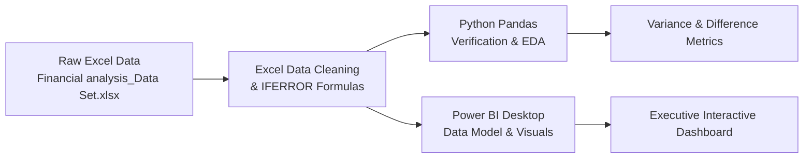

# Budgetary-Analysis
# 📊 Financial Budget vs. Actual Cost Analysis & Variance Reporting

[](https://www.python.org/)
[](https://pandas.pydata.org/)
[](https://powerbi.microsoft.com/)
[](https://www.microsoft.com/excel)
[](https://opensource.org/licenses/MIT)

---

## 📌 Executive Summary

This project presents an end-to-end **Corporate Financial Planning & Analysis (FP&A)** project evaluating the fiscal year 2023 budget against actual business expenditures.

By combining **Microsoft Excel** for data cleaning and error-handled variance calculations (`IFERROR`), **Python (Pandas)** for automated exploratory data analysis (EDA) and numerical verification, and **Microsoft Power BI** for executive-level dashboard reporting, this repository delivers clear visibility into cost overruns, cost savings, and budget allocation efficiencies across operational departments.

---

## 📑 Table of Contents

- [Project Overview](#-project-overview)
- [Key Financial Metrics & KPIs](#-key-financial-metrics--kpis)
- [Tech Stack](#-tech-stack)
- [Data Pipeline & Workflow](#-data-pipeline--workflow)
  - [1. Excel Data Cleaning & IFERROR Variance Formulas](#1-excel-data-cleaning--iferror-variance-formulas)
  - [2. Python Exploratory Data Analysis](#2-python-exploratory-data-analysis)
  - [3. Power BI Dashboards & Visualization](#3-power-bi-dashboards--visualization)
- [Power BI Dashboard Walkthrough](#-power-bi-dashboard-walkthrough)
- [Business Insights & Financial Findings](#-business-insights--financial-findings)
- [Project Directory Structure](#-project-directory-structure)
- [How to Run / Reproduce](#-how-to-run--reproduce)
- [Author & Acknowledgments](#-author--acknowledgments)

---

## 🎯 Project Overview

Managing corporate expenses requires continuous tracking of actual costs against approved budgets. This project analyzes a 12-month expense lifecycle across six major cost centers:

1. **Development Costs** (Core product engineering & software development)
2. **Operational Costs** (Daily facility, utilities, and backend business operations)
3. **Marketing Costs** (Acquisition campaigns, lead generation, and branding)
4. **Travelling Cost** (Onsite client visits, flights, and travel per diems)
5. **Training Cost** (Upskilling programs, certifications, and workshops)
6. **Maintenance Cost** (Software licenses, IT infrastructure, and repairs)

### Primary Objectives:
- Identify monthly and department-level expenditure deviations.
- Clean and normalize raw financial tables handling zero-division risks through robust Excel formulas.
- Automate variance computation and aggregation using Python Pandas.
- Build an interactive Power BI dashboard featuring dynamic slicers, KPI tracking, and proportion benchmarking.

---

## 📈 Key Financial Metrics & KPIs

| Metric | Budgeted (FY23) | Actual Incurred (FY23) | Variance (Actual - Budget) | Status |
| :--- | :---: | :---: | :---: | :---: |
| **Total Expenditure** | **$1,762,200** | **$1,718,180** | **-$44,020** (-2.50%) | 🟢 **Favorable (Under Budget)** |
| **Development Costs** | $1,340,000 (76.05%) | $1,315,100 (76.51%) | -$24,900 (-1.86%) | 🟢 Favorable |
| **Operational Costs** | $165,000 (9.36%) | $174,191 (10.13%) | +$9,191 (+5.57%) | 🔴 Unfavorable (Over Budget) |
| **Training Cost** | $86,000 (4.88%) | $69,500 (4.06%) | -$16,500 (-19.19%) | 🟢 Favorable (Under-spent) |
| **Marketing Costs** | $75,000 (4.26%) | $68,076 (3.96%) | -$6,924 (-9.23%) | 🟢 Favorable |
| **Maintenance Cost** | $48,000 (2.72%) | $41,288 (2.40%) | -$6,712 (-13.98%) | 🟢 Favorable |
| **Travelling Cost** | $48,200 (2.73%) | $50,025 (2.91%) | +$1,825 (+3.79%) | 🟡 Slight Overrun |

---

## 🛠️ Tech Stack

- **Microsoft Excel**:
  - Raw table restructuring and comparative layout design.
  - Calculated fields for `Total Monthly Budget Expenses` and `Total Monthly Actual Expenses`.
  - Advanced error-trapping formula design: `IFERROR(...)` for clean division and null-proof variance computation.
- **Python 3.9+**:
  - `pandas`: Data ingestion, slicing (`head` / `tail`), matrix aggregation, difference and sample variance calculations.
  - `matplotlib`: Baseline visual exploration and sanity checking.
- **Power BI Desktop**:
  - Data Modeling, DAX measures, KPI scorecards.
  - Slicers, Donut Charts, Clustered Bar/Column Charts, and Area Variance Trendlines.

---

## 🔄 Data Pipeline & Workflow



### 1. Excel Data Cleaning & IFERROR Variance Formulas

The raw dataset stored 24 records (12 months of Budget followed by 12 months of Actual expenses) stacked in a single vertical table.

#### Cleaning Steps:
1. **Separation & Restructuring**: Split records into distinct **Budget** and **Actual** structures side-by-side for month-to-month alignment.
2. **Total Calculated Columns**:
   ```excel
   =SUM(B2:G2)
   ```
   Computed the total expenses for each month across the 6 cost categories.
3. **Monthly & Yearly Variance Calculation with `IFERROR`**:
   To prevent runtime formula errors like `#DIV/0!` when a cost category had zero allocations (e.g., Training Cost in March was 0), the calculations were guarded using `IFERROR`:
   
   - **Monthly Variance % Formula**:
     ```excel
     =IFERROR((Actual_Expense - Budget_Expense) / Budget_Expense, 0)
     ```
   - **Yearly / Category Variance % Formula**:
     ```excel
     =IFERROR((SUM(Actual_Range) - SUM(Budget_Range)) / SUM(Budget_Range), 0)
     ```
   - **Variance Difference**:
     ```excel
     =IFERROR(Actual_Expense - Budget_Expense, 0)
     ```

This ensured clean, professional tables ready for Power BI consumption without dirty data or missing value propagation.

---

### 2. Python Exploratory Data Analysis

A Python script was developed to validate Excel's totals, slice subsets, and calculate statistical variances programmatically:

```python
import pandas as pd
import matplotlib.pyplot as plt

# 1. Load the cleaned financial dataset
f = pd.read_excel("Financial analysis_Data Set.xlsx")

# 2. Select relevant financial attributes
d = f[[
    "Month", "Development Costs", "Operatinal Costs", "Marketing Costs",
    "Travelling Cost", "Training Cost", "Maintenance Cost", "Expenses"
]]

# 3. Segregate into Budget (first 12 rows) and Actual (last 12 rows)
b = d.head(12)  # Budget Table
a = d.tail(12)  # Actual Table

# 4. Sum expenses across categories
cost_cols = [
    "Development Costs", "Operatinal Costs", "Marketing Costs",
    "Travelling Cost", "Training Cost", "Maintenance Cost"
]
bc = b[cost_cols].sum()  # Total Budget per category
ac = a[cost_cols].sum()  # Total Actual per category

# 5. Compute Dollar Differences & Variance
diff = ac - bc              # Difference per cost center (Actual - Budget)
total_diff = diff.sum()     # Net FY difference (-$44,020)
total_variance = diff.var() # Cross-category variance
```

---

### 3. Power BI Dashboards & Visualization

The Power BI solution is structured into two main analytical views:

#### 📊 View 1: Expense Proportions & Monthly Breakdown
- **Slicers**: Toggle between `All`, `Budget`, and `Actual` views.
- **Proportions of Budget (Pie Chart)**:
  - Highlights baseline budget weighting (Development dominates at **76.05%**, followed by Operational at **9.36%**).
- **Proportions of Actual Expenses (Donut Chart)**:
  - Realized distribution (Development **76.51%**, Operational **10.13%**, Training **4.06%**).
- **Monthly Actual vs Budget Ranking (Horizontal Bar Charts)**:
  - Instant monthly audit showing peak spend in November ($151,154) and December ($151,290).

#### 📈 View 2: Executive Budget vs. Actual & Variance Trends
- **KPI Headline Cards**:
  - `Total Budget`: **1,762,200**
  - `Actual Expenses`: **1,718,180**
  - `Variance Index`: **0.33**
- **Budget vs. Actual Clustered Column Chart**:
  - Side-by-side cost center benchmarking.
- **Sum of Variance by Expenses (Pie Chart)**:
  - Shows where variance originated (Training Cost contributed **45.12%** of variance deviation, followed by Marketing at **30.09%**).
- **Monthly Difference & Variance Area Chart**:
  - Displays monthly spending trajectory with a noticeable surplus peak in July (+$15.2K saved) and minor overspending in April (-$5.9K).

---

## 🖼️ Dashboard Preview

*(Place your exported Power BI screenshots in an `assets/` or `images/` folder in your repo)*

| Dashboard View 1: Proportions & Monthly Totals |
| :---: | :---: |
 

| Dashboard View 2: Executive Variance Analysis |


| Raw Data Structure | Cleaned Data & Calculated Columns |
| :---: | :---: |
| ![Raw Excel Data] 
| ![Cleaned Excel Data] 


---

## 💡 Business Insights & Financial Findings

1. **Overall Fiscal Health (Under Budget)**:
   - The company completed FY23 with a **favorable net savings of \$44,020** (~2.5% below total allocated budget of \$1.76M).
2. **Operational Overrun Alert**:
   - `Operational Costs` exceeded their budget by **\$9,191 (+5.57%)**, reaching \$174,191. Facility and operational workflows should be reviewed to curb recurring creep.
3. **Training & Marketing Under-utilization**:
   - `Training Cost` had the largest single category underspend (**-\$16,500 / -19.19%**), which explains **45.12%** of total expense variance. In March 2023, zero training was recorded against a \$6,000 budget.
   - `Marketing Costs` came in **\$6,924 below budget**, suggesting opportunities to either reallocate funds into growth campaigns or right-size future marketing allocations.
4. **Seasonal Spending Dynamics**:
   - Spending was highest during Q4 (Nov & Dec exceeded \$151,000/month), while **July experienced the steepest savings delta** (actual spend \$133,733 vs. \$149,000 budget).

---

## 📂 Project Directory Structure

```plaintext
├── data/
│   └── Financial analysis_Data Set.xlsx    # Cleaned & original dataset with IFERROR formulas
├── notebooks/
│   └── financial_analysis.py               # Python verification and data manipulation script
├── power_bi/
│   └── Financial_Analysis_Report.pbix      # Interactive Power BI dashboard file
├── images/
│   ├── dashboard_proportions.png           # Power BI dashboard page 1
│   ├── dashboard_variance_analysis.png     # Power BI dashboard page 2
│   ├── raw_excel_data.png                  # Raw dataset preview
│   └── cleaned_excel_data.png              # Cleaned dataset with calculated fields
├── README.md                               # Project documentation & execution guide
└── requirements.txt                        # Python library dependencies
```

---

## 🚀 How to Run / Reproduce

### Prerequisites
- Python 3.8+
- Microsoft Excel 2016 or newer (or Office 365)
- Power BI Desktop (Free download from Microsoft)

### Step 1: Clone the Repository
```bash
git clone https://github.com/your-username/financial-budget-actual-analysis.git
cd financial-budget-actual-analysis
```

### Step 2: Set Up Python Environment
```bash
python -m venv venv
# Windows:
venv\Scripts\activate
# macOS/Linux:
source venv/bin/activate

pip install -r requirements.txt
```
*(or install directly: `pip install pandas openpyxl matplotlib`)*

### Step 3: Run the Analysis Script
```bash
python notebooks/financial_analysis.py
```

### Step 4: Open Power BI Dashboard
1. Launch **Power BI Desktop**.
2. Open `power_bi/Financial_Analysis_Report.pbix`.
3. If prompted to refresh data sources, select **Transform Data** > **Data source settings** and point to `data/Financial analysis_Data Set.xlsx`.

---

## 📄 License

This project is licensed under the [MIT License](LICENSE) - feel free to use, modify, and distribute for personal and commercial analytics portfolio work.
